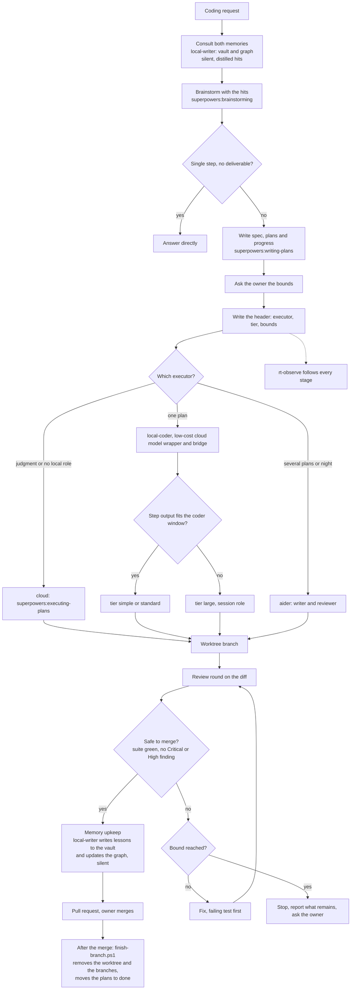

# Local coding and the cloud

Chapter 12 of the ResearchTools manual. Back to [table of contents](../../README.md).

This chapter answers one question for any piece of coding: does it run on the cloud, through
`local-coder`, through aider, or on a session you switched by hand, and who decides. It also
says what the process costs, what stops it, and what the dashboard shows. The rule behind it is
R38 in `.claude/rules/workflows.md`, and it binds every project on a machine where ResearchTools
is installed.

## Why local coding exists

A local model generates code on your GPU, so that generation costs no cloud tokens. The cloud
still pays for the plan, for a small wrapper on a low-cost cloud model that drives the local
model, and for the review of the result. Local coding saves tokens only while four things hold: the plan is
dispatched to the local agent as a whole, the review loop is bounded, the explanation of the
mechanism is correct, and you can see what the local model is doing. Four failures defeated it
before this chapter: `local-coder` was never dispatched because it took one task per call, the
review loop of R35 repeated until no finding with no maximum (seven unbounded iterations were
measured on 2026-10-17), the documentation gave a wrong reason for the bridge, and local work
was barely visible in the dashboard.

## The process



The source of this diagram is [local-coding-flow.mmd](diagrams/local-coding-flow.mmd), and a
test fails when the two differ. Reading it from the top:

- Before the brainstorm, `local-writer` consults both memories, the Obsidian vault for past
  decisions and failures and the code graph for questions about this code, and returns distilled
  hits that are folded into the brainstorm. The session never reads either itself, and the
  consult prints nothing in the chat.
- A request that is a single step with no deliverable of its own, such as reading one file, is
  answered directly. Anything larger gets plan files first.
- The session asks you for the review bounds before it writes the plan header, because the
  header carries them.
- The executor decision has three outcomes: the session itself runs the plan, one plan goes to
  `local-coder`, or several plans go to aider.
- For `local-coder` the question is whether each step's prompt plus output fits the coder
  window. If it does not and the step cannot be split, the plan takes the large tier.
- Every path ends in the same place: a worktree branch and a review round on its diff. The loop
  stops when the branch is safe to merge, meaning the full suite is green and a re-graded round
  leaves no Critical or High finding, minors being deferred and listed. Otherwise a round
  that still finds something is fixed with a failing test first, until a bound stops the loop
  and the session reports what remains and asks you.
- A safe branch gets a last memory upkeep: `local-writer` writes the lessons to the vault and
  updates the graph for the code that was added, then the pull request opens and you merge.

## Choosing an executor

| Situation | Executor | Why it saves cloud tokens |
|---|---|---|
| Judgment, security, design, a repository-wide change, or no qualified local role | The session itself, with `executing-plans` | Nothing to save: the work needs the best model |
| One plan, a test as oracle per step, each step's prompt plus output fits the coder window | `local-coder`, tier simple or standard | The cloud pays for the plan, the wrapper and the review; the code is generated locally |
| One plan whose step output cannot fit the coder window and cannot be split | `local-coder`, tier large | Same, with a window large enough for long output |
| Two or more plans, or an unattended night | aider (spec, plan files, progress, a writer model and a reviewer model) | No interactive harness is involved once the run starts |
| A whole session on Ollama or Augure | Your manual choice with `claude-switch.ps1`, never written in a plan | The session itself is local |

Fit is measured with `context_budget.py --role` and `token_count.py`, never guessed. A fix found
by a review round is a small plan of its own and follows the same table.

## Plan files come first

Any coding request beyond a single step gets `spec.md`, `plan<N>.md` and `progress.md` before the
first line of code, with the size ceilings below. Each plan opens with a header:

- `executor`: `local-coder`, `aider` or `cloud`.
- `tier`: `simple`, `standard` or `large`.
- `bounds`: `max_rounds`, `max_tokens` and `plateau`, positive integers.

The cloud model writes `executor` and `tier` after asking you the bounds with a question that
states what each choice costs. The bounds count input, cache creation and output tokens, with
cache reads excluded, because money is not readable from this machine. `plan_contract.py
validate <plan>` checks the header, the file limit of the tier and the size ceilings, and
`plan_contract.py resolve <plan>` maps the tier to a resolver role. No plan names a model: the
resolver names the tag at run time.

## A skill for every step

Rule R36 says that all tasks, any task, need a skill, or an agent that itself uses one. The
process of this chapter obeys it at each step, so no step is run from memory. A step with no
skill is a gap to report, never a step run without one.

| Step | Skill | Notes |
|---|---|---|
| Request | `superpowers:brainstorming` | Explores what is wanted before any plan exists |
| Plan files | `superpowers:writing-plans` | Writes the spec, the plans and the progress ledger, with the header |
| Execution | `superpowers:executing-plans` | Also loads test-driven development. A `local-coder` dispatch is made by a session that follows it |
| Review | `code-review` and `security-review` | Under the bounds of R35 |
| Pull request | `superpowers:finishing-a-development-branch` | You merge, never the session |

**After the merge.** The last step is a script, not a skill, because it only runs git and `gh`:
`scripts/test/finish-branch.ps1`, started from the main clone. It removes the branch's worktree,
deletes the branch locally and on origin, prunes, and moves the plans folder from
`docs/superpowers/todo/` to `done/`. It does nothing until you add `-Yes`, and it never uses
`--force`.

```powershell
cd <main clone>
.\scripts\test\finish-branch.ps1 -Branch feat/my-branch                 # dry run: lists the steps
.\scripts\test\finish-branch.ps1 -Branch feat/my-branch -Yes -PlansFolder 2026-10-17-my-effort
```

It refuses, and says why, when `gh` finds no merged pull request for the branch, when the local
branch holds commits that were never pushed, when origin's branch has a commit pushed after the
merge or origin cannot be queried (an unreachable origin is never read as a branch that is gone), when the main clone has modified tracked files (R32), when the worktree has uncommitted files,
git-ignored files (add `-DiscardIgnored` once you have kept what you need) or holds a
junction or a symbolic link (removing it would follow the link and delete its target, R37), when
the main clone is not on `main` (it never switches the checked-out branch, R32), or when it was
started from inside the worktree it would remove. A second run finds nothing to clean and exits 0.

A similar toolset may replace the three process skills, for example the `speckit-*` skills
(`speckit-specify`, `speckit-plan`, `speckit-tasks`, `speckit-implement`), and the plan still
names the skill used at each step. ruflow was named by the owner and is not installed or
verified here, so no step relies on it. Aider is its own harness and sits outside this rule.

## Size ceilings

The ceilings are not written in the rules. They are the `ceilings` of
`.claude/skills/aider-setup/config/context-budget.json`, the single source for every project,
read when this chapter was written on 2026-10-17. The operator cut them on 2026-09-05 because
every token of ceiling is reserved window, which is KV cache, which is model weights pushed off
a small GPU.

| File | Ceiling in tokens |
|---|---:|
| `spec.md` | 4000 |
| `plan.md` | 4000 |
| `progress.md` | 2048 |
| `audit.md` | 4096 |
| `code_file` | 16000 |

`plan.md` applies to each `plan<N>.md`. A test reads the budget file and fails when this table
drifts from it. To count, run `python .claude/skills/loop-engineer/scripts/token_count.py
<file or folder>`. With a tokenizer installed it uses the encoder aider uses and says the count
is exact for that encoder. Without one it estimates characters over four and multiplies by 1.25
before a ceiling check, because real over estimated tokens ranged from 0.99 to 1.20 on the
twelve files of this effort (measured 2026-10-17). It never calls an estimate exact. Three older
counters remain on purpose, because the aider kit is standalone: `Get-TokenCount` in
`aider-plan-core.ps1`, `count_tokens` in `aider-rules-sync.py` and `estimate_tokens` in
`context_budget.py`.

## The four paths

**The session runs the plan.** The header says `executor: cloud` and the session follows
`executing-plans` in a worktree. This is the path for judgment, security work, and any plan on a
machine with no qualified local role.

**One plan through `local-coder`.** The dispatch prompt carries a line `PLAN: <path>`. The
agent resolves the tier to a role with `plan_contract.py resolve`, generates each open step over
the bridge, ticks `progress.md` with one of three marks and nothing else (`- [ ]` open, `- [x]`
done, `- [!]` blocked), and reports. It audits nothing and never commits. Review runs in the
calling session.

**Several plans through aider.** Aider keeps its own internal loop: a writer model codes and
tests, and a different reviewer model audits and never edits. It reads `spec.md`, each
`plan<N>.md` and `progress.md`, and a plan header does not change the files it names. See
chapter [06](06-aider-pipeline.md).

**A whole session switched by hand.** `claude-switch.ps1` provides `claude-ollama`,
`claude-augure` and `claude-cloud`. This is your choice and is never written in a plan.

## Roles, windows and speed

A tier maps to a resolver role through `plan-tiers.json`, and the role to a model through the
resolver. The figures below were read from the files that hold them when this chapter was
written, and each row says where.

| Tier | Role | Window | Decode speed | Source and date |
|---|---|---|---|---|
| simple, standard | coder | 16384 tokens | about 26.6 tokens per second | Read 2026-10-17 from `local-model-config.json` (sweep by `optimize_ollama.py`) |
| large | session | 262144 tokens, stored with `--num-ctx` | about 2.4 tokens per second | Adoption of 2026-10-09 in `local-model-state.json`, thread sweep by `aider-thread-probe.py`; the entry on this machine records no window yet |
| any | none qualified | not applicable | not applicable | Read 2026-10-17: with no qualified role the plan runs on the cloud executor |

The large tier is the low-cost cloud model wrapper plus the bridge with the session role. It is not a subagent
on a local endpoint, which Claude Code does not offer. At about 2.4 tokens per second a 4000
token file takes roughly 28 minutes to generate, so use it only when a step truly cannot be
split.

## What the wrapper does and costs

`local-coder` and `local-writer` run on a low-cost cloud model that frames the task, assembles
one self-contained prompt, checks it fits the window, runs the bridge with the role, reads the
result and writes it. The bridge speaks Ollama's HTTP API, asks the resolver for the model, and
refuses rather than substituting a weaker one. The wrapper is the only cloud generation cost of
a local step, and it is small because it never writes the code itself.

The reasoning stays with an edge cloud model, which writes the plans and reviews the result.
This chapter names no model, because the process holds for any cloud model. One limit applies to
all of them: a subagent has no endpoint of its own, so a model from another provider is
reachable only by switching the whole session, which Claude Code does not support. The
`claude-augure` switch of the paths above is that case.

## When memory is read and written

Both memories, the vault and the graph, are reached through `local-writer` and nothing else. The
full table, with how each result is verified, is the Memory rule of
[workflows.md](../../.claude/rules/workflows.md). The rows are:

| Event | Action | Target |
|---|---|---|
| Before brainstorming or planning a non-trivial task | Read | Vault: past decisions and failures on the subject. Graph: only for a question about this code |
| Loop start | Read | Vault, same scope as above |
| Checkpoint in a loop | Read | Vault, the project `Decisions.md` |
| Error recovery | Read | Vault lessons on the error signature |
| A failure with a root cause | Write | Atomic lesson note under the technology folder of the vault |
| Loop checkpoint | Write | Project `Decisions.md`, and `CodeReview.md` with the score |
| Significant review finding | Write | Project `CodeReview.md`, plus an atomic note when the pattern is reusable |
| Gate reached or loop finished | Write | Project `index.md` properties (score, release) |
| Correction or new method | Write | Atomic method note, and the project `Revisions.md` |
| Code added or changed | Write | Graph refresh with `graphify update` on the repository root, AST only unless a document changed |
| End of the task, before the pull request | Write | A last upkeep pass: the lessons, the project log, the graph |
| Execution wrapper (`executing-plans`) and cloud review | Never read | Nothing: the plan already carries the knowledge |
| `local-coder` | Never reads or writes | It reports a learning to the session, which hands it to `local-writer` |

The dispatch runs in the background, as one agent, sequential, never a fan-out. On success it
prints nothing in the chat except one short line of counts and paths, and the session says
nothing about it. The result reaches the session later. A failure is shown in full, and the
session then adapts: a missing note is a write to redo, and a lesson that changes the approach
changes the plan or the spec. A write that is never reported back is treated as not done. The
silence on success is tested in `test_memory_silence.py`, and the live effect needs the synced
settings of your machine, so it is unverified until a real session shows it.

## Review bounds and the two hooks

Before the first review round the session asks you for the three bounds and runs
`loop_bounds.py init`. After each round it runs `loop_bounds.py tick --findings N`. Two
PreToolUse hooks enforce the contract, both declared in `settings.template.json`, and each exits
silently when its dependency is absent:

- `review-loop-guard.py` guards the review skills. It refuses with the command to run when no
  bounds are declared, and with the bound reached when `max_rounds`, `max_tokens` or the
  plateau is spent. A refused call does not consume a round.
- `local-coder-dispatch-guard.py` guards the dispatch of `local-coder`. It refuses a prompt with
  no `PLAN:` line, a plan outside the repository or over a ceiling, a plan whose executor is not
  `local-coder`, and a plan whose tier has no qualified role.

Messages you will meet: "no review-loop bounds are declared for this branch" with the init
command, "max_rounds reached for code-review", and "a local-coder dispatch must name its plan".
When a bound stops the loop before a clean round, the session reports what remains and asks you
whether to raise it. It never opens the pull request on its own.

## Every project, and the cloud fallback

Once ResearchTools is installed the contract binds every project on the machine: the rule is in
the exported part of `.claude/CLAUDE.md`, the rules folder is shared, and the hooks come from
the settings template. On a machine with no qualified model for the tier, `plan_contract.py
resolve` returns the cloud executor with the reason, and the plan is executed in the session.
It never falls back to a weaker local model.

## What the dashboard shows

`rt-observe` follows the work from three snapshot sections. `local_calls` reads a bounded tail of
the bridge log and shows each role with its model, window, calls, tokens and whether it is
active. `rounds` lists each plan of a round folder with its executor, tier and task counts, and
the review loop of every worktree as rounds used of the maximum. The Real-Time tab draws a lane
and a token ring for each active bridge role, and shows an aider run's fixed cost and task
budget. See chapter [07](07-rt-observe-dashboard.md).

## What is verified, unsupported and untried

Read from the Claude Code documentation on 2026-10-17:

- Claude Code has one API endpoint per process and no per-subagent endpoint, environment or
  provider, so a subagent cannot be pointed at Ollama while the main session stays on
  Anthropic. That, and not the subscription, is why local models go through the bridge.
- Switching the whole session with `claude-switch.ps1` works and was measured here, but
  Anthropic documents that it does not support routing Claude Code to non-Claude models through
  a gateway, and Remote Control is unavailable while the base URL is not api.anthropic.com.
- A model ID Claude Code does not recognise is assumed to have a 200K window unless
  `CLAUDE_CODE_MAX_CONTEXT_TOKENS` is set. Whether that variable is capped at the model's own
  window is not documented and is untried here.

Also untried until one live firing on this machine: that both hooks fire on their matchers.

## Troubleshooting

- A review is refused with no bounds: ask for the three bounds, then run the init command the
  message names. Whether a review typed by hand reaches the hook is unverified, so declare `--max-rounds 1` first as the one-shot.
- A dispatch is refused: add the `PLAN:` line, or fix the header key the message names.
- The plan resolves to the cloud: no model is qualified for the tier's role. Qualify one with
  the resolver, or run the plan in the session.
- The session role has no window: adopt it again with `--num-ctx`, then try `claude-local` once.
- The page shows no local lane: the bridge log has no record with a role yet, and the section
  says why instead of drawing an empty panel.
